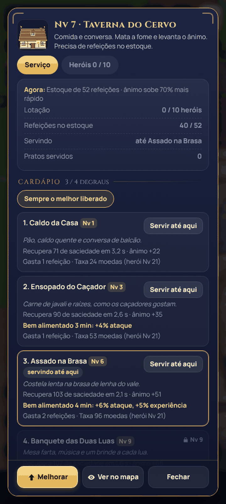
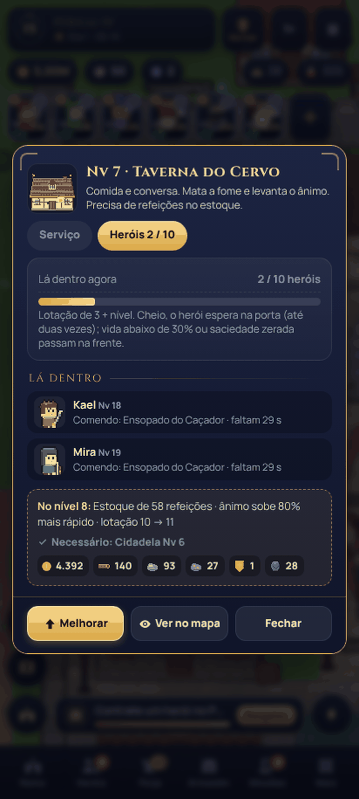
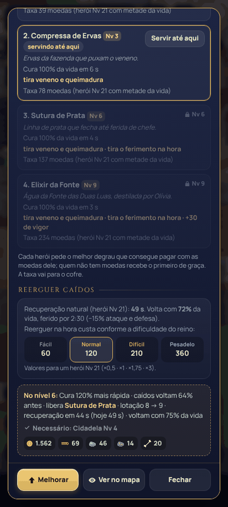
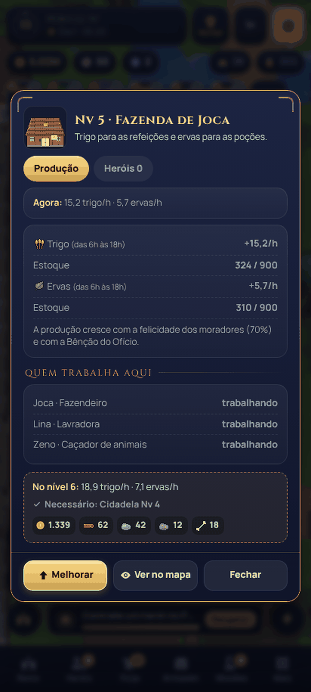
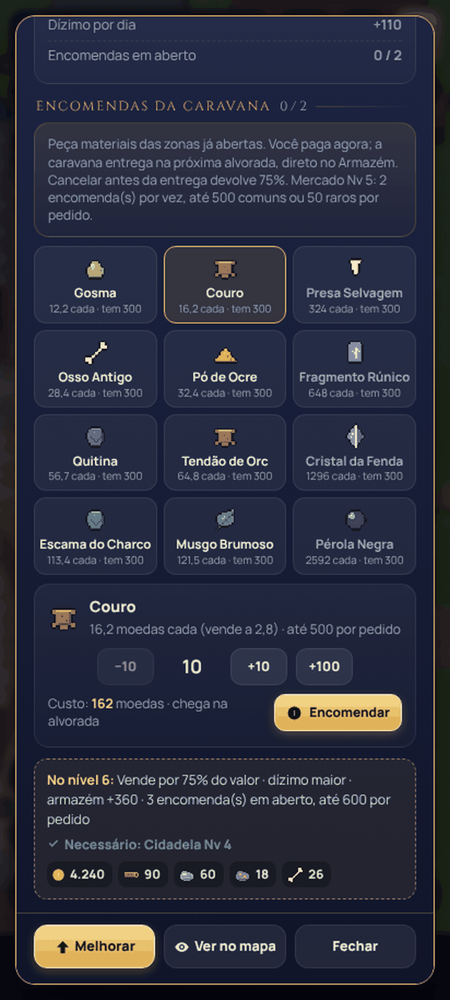
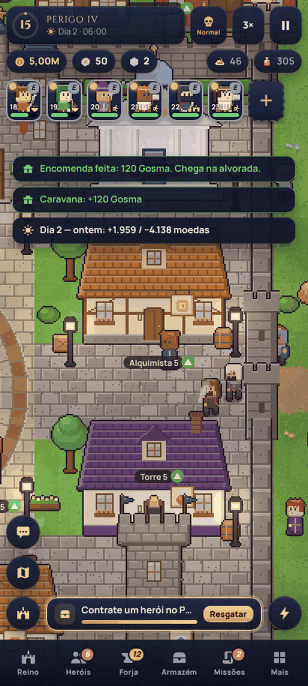
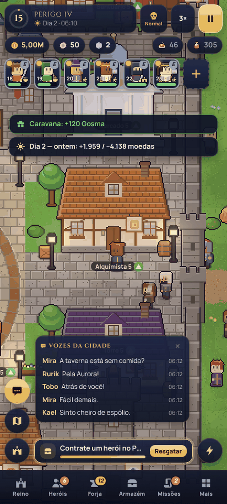
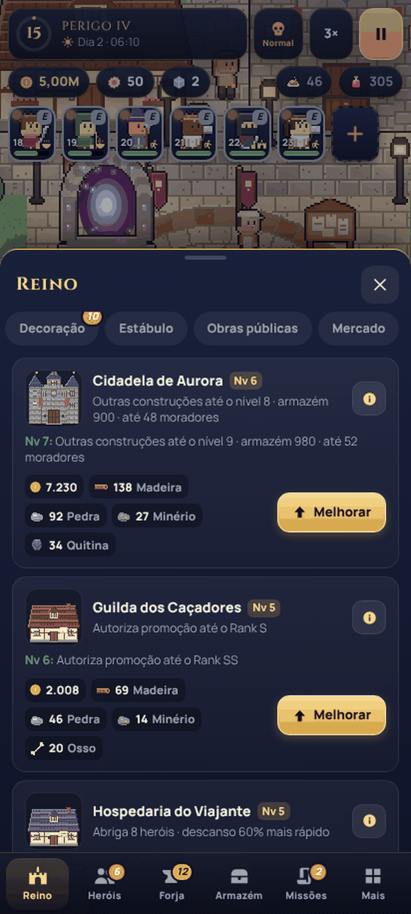

# Aurora — Crônicas da Fenda

Cidade viva de caçadores em um único arquivo HTML: os heróis caçam sozinhos, você ergue a cidade,
forja o equipamento e enfrenta a Fenda. Funciona offline, no celular ou no computador.

## v23 "Ofícios" — versão mais recente

**Arquivo:** [aurora-cidade-viva-23.html](aurora-cidade-viva-23.html) (baixe e abra no navegador)

Cada prédio abre um painel com serviço, heróis lá dentro, lotação e prévia do próximo nível; Taverna,
Hospedaria e Enfermaria têm cardápios em quatro degraus; reerguer custa conforme a dificuldade; o Mercado
aceita encomendas de material; e as falas dos heróis ficam num registro. Saves antigos continuam valendo.
[O que mudou e a campanha de teste](melhorias-v23.md) · [Verificação](verificacao-v23.json)

| | | | |
|---|---|---|---|
|  |  |  |  |
|  |  |  |  |

## Versões anteriores

- [aurora-cidade-viva-22.html](aurora-cidade-viva-22.html) — v22 "Companheiros": espólio no chão,
  mascotes com raridade e Incursões. [O que mudou](melhorias-v22.md) ·
  [Verificação](verificacao-v22.json) · capturas em `telas-v22/`.
- [aurora-cidade-viva-21.html](aurora-cidade-viva-21.html) — v21 "Legado": trajes, asas, relíquias,
  dificuldade, enfeites móveis e Caminhos. [O que mudou](melhorias-v21.md) ·
  [Verificação](verificacao-v21.json) · capturas em `telas-v21/`.
- [aurora-cidade-viva-20.html](aurora-cidade-viva-20.html) — v20 "Vocações": árvore de vocações, Artes
  Secretas, Despertar, montarias, oito peças de equipamento, Armazém e decoração.
  [Mecânicas e árvores](melhorias-v20.md) · [Verificação](verificacao-v20.json) · capturas em `telas-v20/`.
- [aurora-cidade-viva-19.html](aurora-cidade-viva-19.html) — v19 "Reforjada", base desta versão.

## Fontes

Cada versão é montada a partir da anterior por um script: `fontes-v20/build.py` leva a v19 à v20 e
`fontes-v21/build.py` leva a v20 à v21 `fontes-v22/build.py` leva a v21 à v22 e `fontes-v23/build.py` leva a v22 à v23. Cada pasta tem a lista de trocas pontuais no código existente,
os arquivos novos em `mod/` (lógica, arte, interface e estilos) e um `testar.sh` que remonta e verifica.
