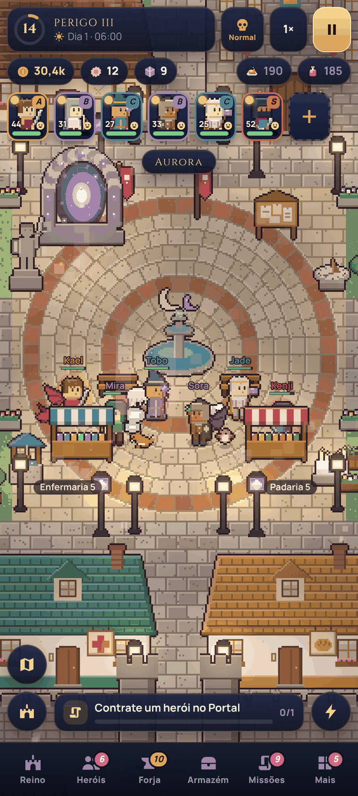
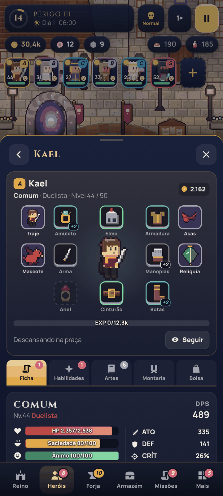
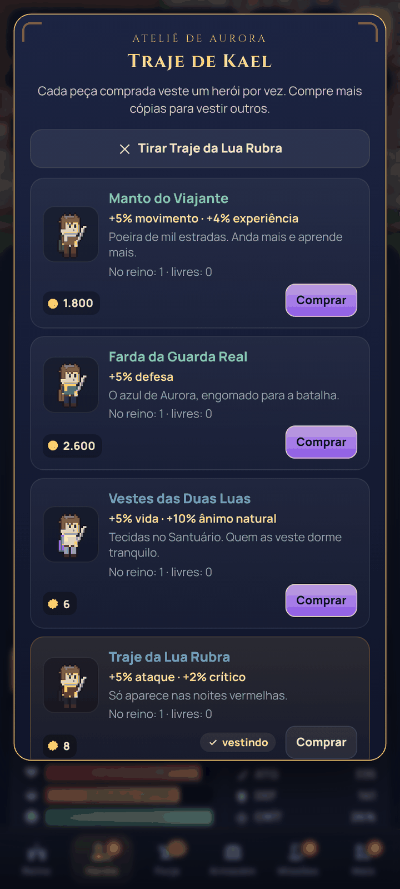
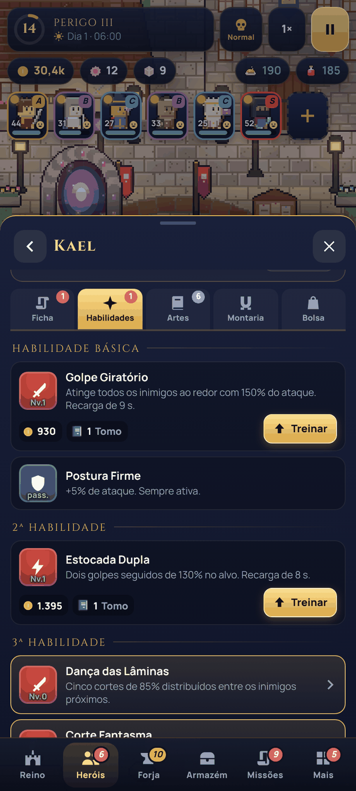
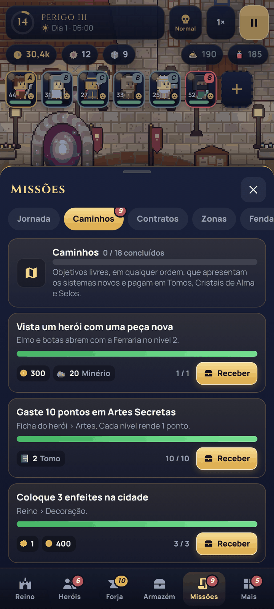
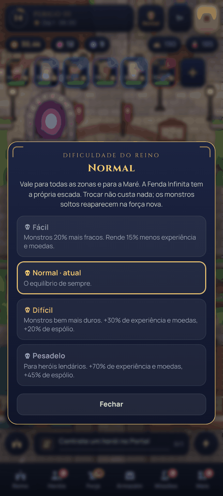
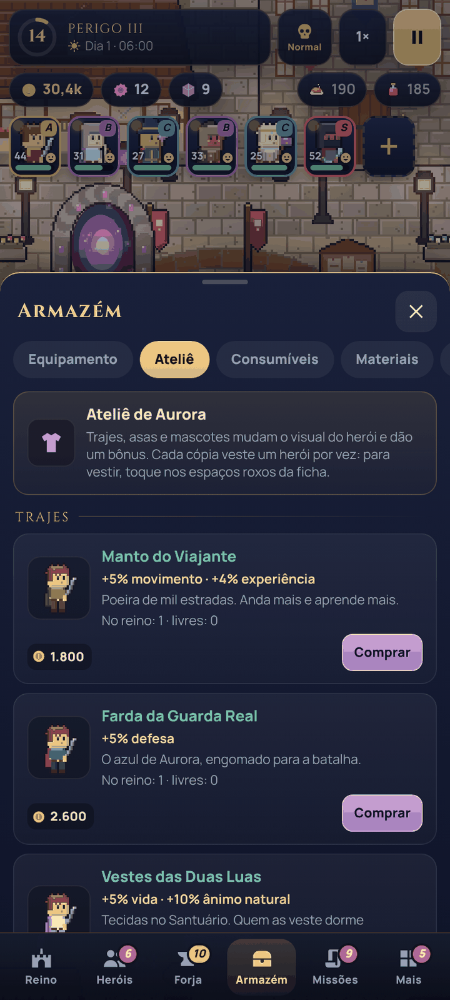
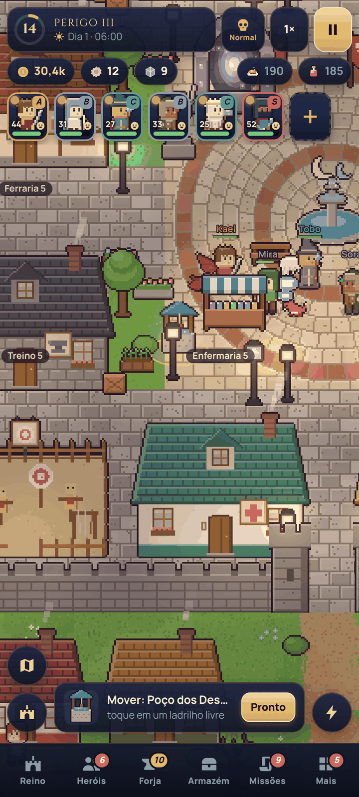

# Aurora — Crônicas da Fenda

Cidade viva de caçadores em um único arquivo HTML: os heróis caçam sozinhos, você ergue a cidade,
forja o equipamento e enfrenta a Fenda. Funciona offline, no celular ou no computador.

## v21 "Legado" — versão mais recente

**Arquivo:** [aurora-cidade-viva-21.html](aurora-cidade-viva-21.html) (baixe e abra no navegador)

Novidades sobre a v20: trajes, asas e mascotes que aparecem no mapa, relíquias dos chefes, quatro
níveis de dificuldade, enfeites que mudam de lugar e 18 Caminhos com recompensas. Saves da v19 e da
v20 continuam valendo. [O que mudou e a campanha de teste](melhorias-v21.md) ·
[Verificação](verificacao-v21.json)

| | | | |
|---|---|---|---|
|  |  |  |  |
|  |  |  |  |

## Versões anteriores

- [aurora-cidade-viva-20.html](aurora-cidade-viva-20.html) — v20 "Vocações": árvore de vocações, Artes
  Secretas, Despertar, montarias, oito peças de equipamento, Armazém e decoração.
  [Mecânicas e árvores](melhorias-v20.md) · [Verificação](verificacao-v20.json) · capturas em `telas-v20/`.
- [aurora-cidade-viva-19.html](aurora-cidade-viva-19.html) — v19 "Reforjada", base desta versão.

## Fontes

Cada versão é montada a partir da anterior por um script: `fontes-v20/build.py` leva a v19 à v20 e
`fontes-v21/build.py` leva a v20 à v21. Cada pasta tem a lista de trocas pontuais no código existente,
os arquivos novos em `mod/` (lógica, arte, interface e estilos) e um `testar.sh` que remonta e verifica.
