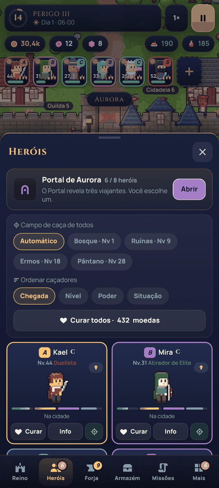
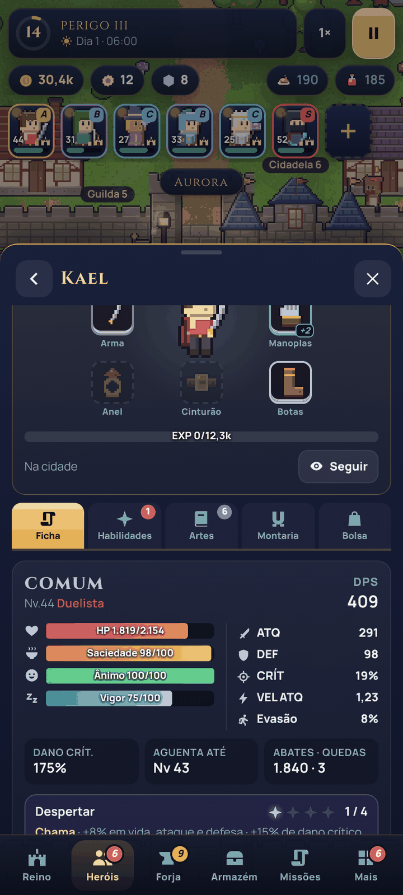
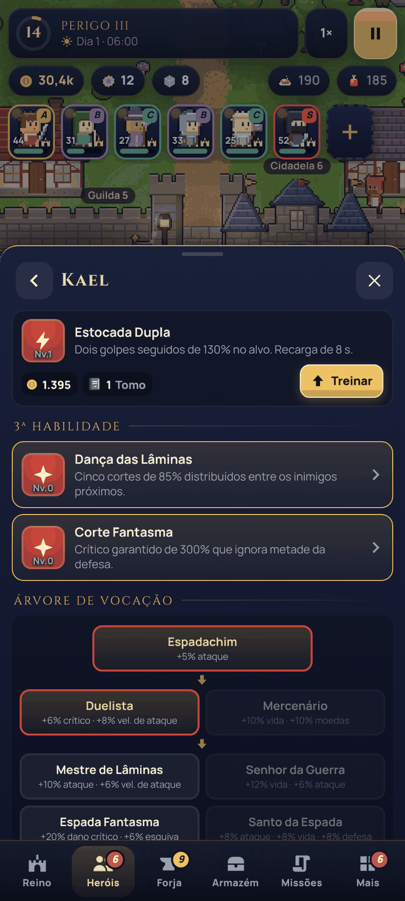
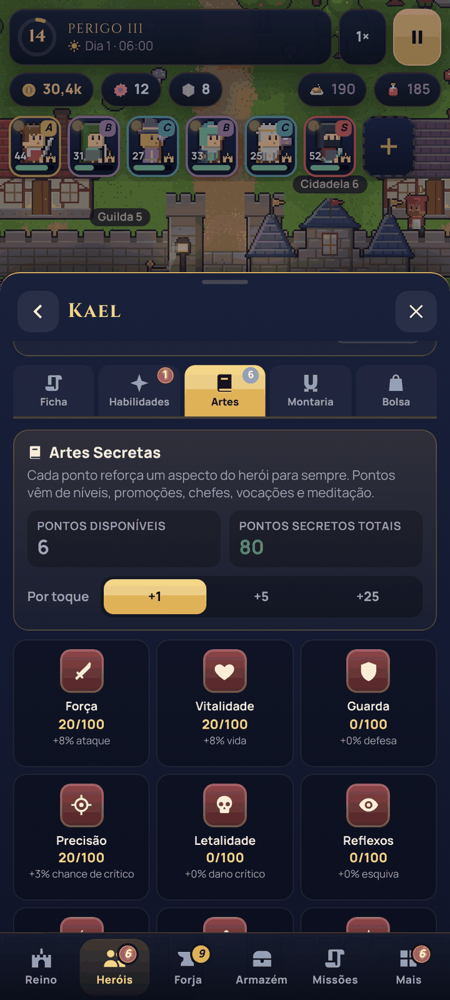
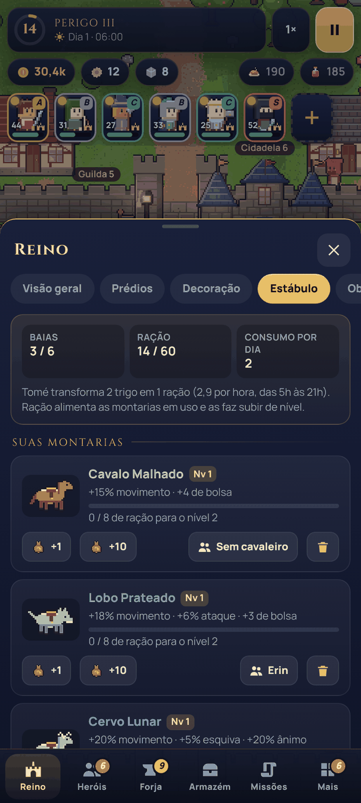
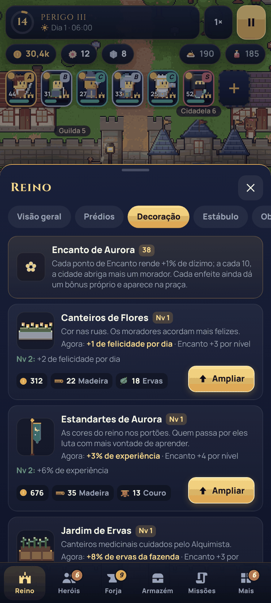
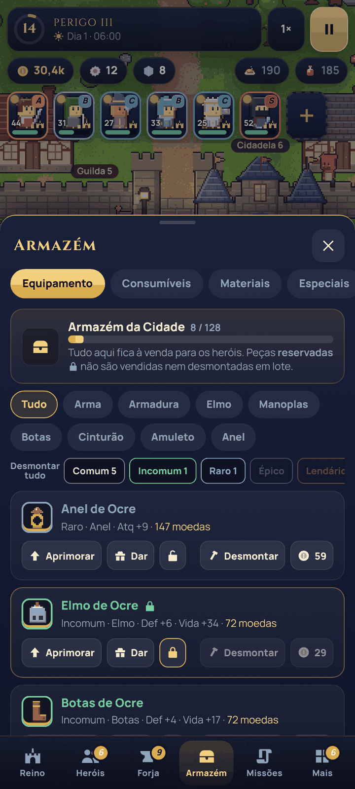
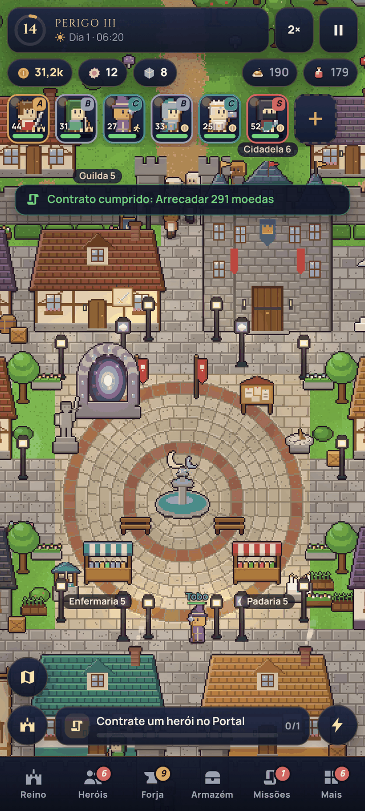

# Aurora — Crônicas da Fenda

Cidade viva de caçadores em um único arquivo HTML: os heróis caçam sozinhos, você ergue a cidade,
forja o equipamento e enfrenta a Fenda. Funciona offline, no celular ou no computador.

## v20 "Vocações" — versão mais recente

**Arquivo:** [aurora-cidade-viva-20.html](aurora-cidade-viva-20.html) (baixe e abra no navegador)

Novidades: árvore de vocações com 36 classes e habilidades, Artes Secretas, Despertar, montarias e
Estábulo, oito peças de equipamento, Armazém com desmonte, decoração da praça e o Mascate errante.
O save da v19 continua valendo. [Mecânicas, árvores e limites](melhorias-v20.md) ·
[Verificação](verificacao-v20.json)

| | | | |
|---|---|---|---|
|  |  |  |  |
|  |  |  |  |

## Versões anteriores

- [aurora-cidade-viva-19.html](aurora-cidade-viva-19.html) — v19 "Reforjada", base desta versão.

## Fontes da v20

A v20 é montada a partir da v19 por `fontes-v20/build.py`: uma lista de trocas pontuais no código
existente (`patches_core.py`, `patches_ui.py`) e quatro arquivos novos em `fontes-v20/mod/`
(lógica, arte, interface e estilos). `sh fontes-v20/testar.sh` remonta e verifica.
